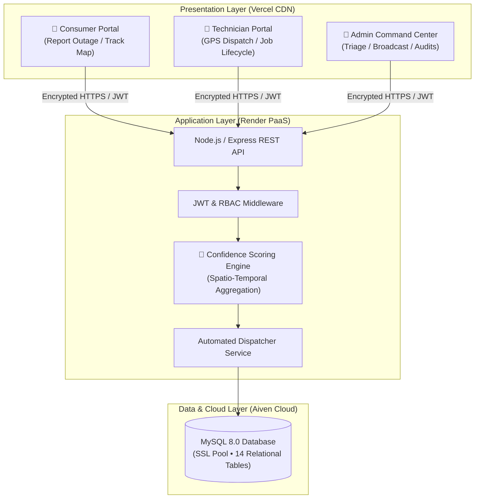
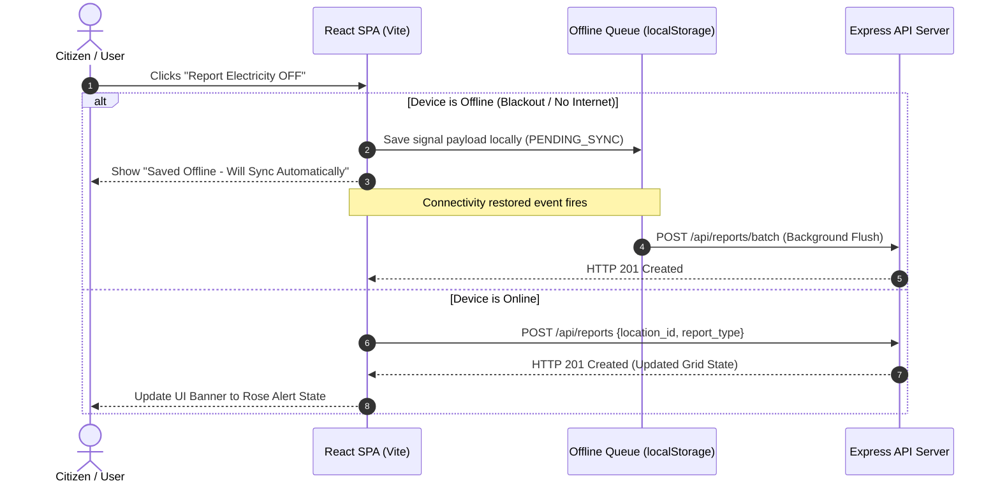
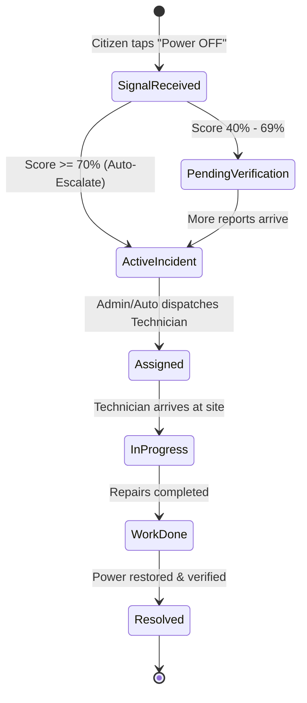
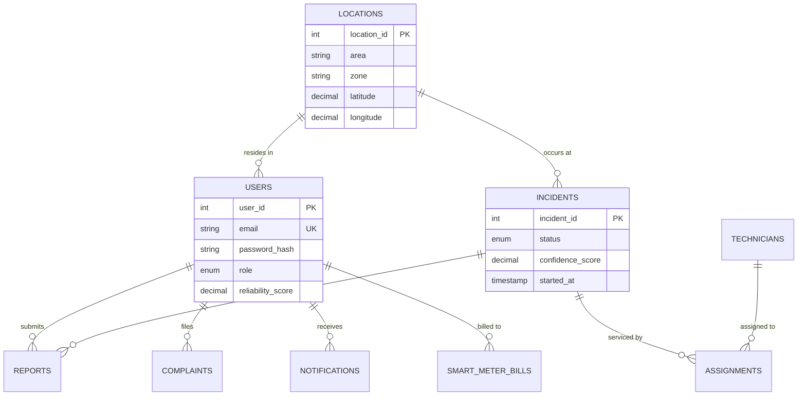

# ⚡ PowerPulse: Smart Electricity Outage Intelligence & Management Platform
## Project Defense & Presentation Slides

> **System:** Distributed Cloud-Native Utility & Civic-Tech Platform  
> **Authors:** Md. Tarikul Islam & Sujoy Devnath  
> **Target Audience:** Project Examiners, Faculty Evaluators & Industry Panelists  

---

```
                                  SLIDE DECK OVERVIEW
┌────────────────────────────────────────────────────────────────────────────────────────┐
│  SLIDE 1-3:   Project Genesis, Problem Motivation & Global System Architecture        │
│  SLIDE 4-8:   PART I  — FRONTEND ARCHITECTURE, USER PORTALS & CLIENT-SIDE UX           │
│  SLIDE 9-12:  PART II — BACKEND ARCHITECTURE, SECURITY & CONFIDENCE SCORING ENGINE     │
│  SLIDE 13-14: PART III— DATABASE DESIGN (CLOUD MYSQL) & DEVOPS DEPLOYMENT PIPELINE     │
│  SLIDE 15-16: Viva Defense Key Arguments, Future Roadmap & Conclusion                 │
└────────────────────────────────────────────────────────────────────────────────────────┘
```

---

## 🖥️ Slide 1: Title Slide
### PowerPulse: Smart Electricity Outage Intelligence & Grid Management

* **Subtitle:** Eliminating the "Last-Mile Distribution Blind Spot" through Real-Time Spatio-Temporal Crowdsourcing, IoT Heartbeat Simulation & Automated Technician Dispatch.
* **Presenters:** Md. Tarikul Islam & Sujoy Devnath
* **Platform Stack:** React 19 • Node.js/Express • Aiven Cloud MySQL 8.0 • Vercel • Render
* **Live URLs:**
  * Client Portal: `https://power-pulse-app.vercel.app`
  * API Gateway: `https://powerpulse-api-j8oc.onrender.com/api`

> [!NOTE]
> **Presenter Talking Point (কী বলবেন):**  
> *"Good morning respected faculty. Today we present PowerPulse—a full-stack, distributed utility intelligence platform designed to bridge the visibility gap between municipal power grids and citizen consumers."*

---

## 🎯 Slide 2: Problem Statement & Motivation
### The "Last-Mile Grid Blind Spot"

* **The Reality of Modern Power Grids:**
  * Central SCADA and smart sensors exist at **Substations (33kV/11kV)** and primary feeders.
  * However, **90% of urban power disruptions occur at the last mile**: blown transformer fuses (LT Drop-outs), phase drop-offs, fallen tree limbs, or localized service-drop cable burns.
* **The Call-Center Bottleneck:**
  * During blackouts, utility call centers receive thousands of duplicate, chaotic calls.
  * Central operators cannot differentiate between a single home fuse outage versus an entire 500-household neighborhood blackout.
* **The PowerPulse Solution:**
  * Transform citizens' smartphones into **virtual edge sensors**.
  * Combine crowdsourced citizen alerts with simulated smart-meter IoT heartbeats to detect, verify, and triangulate grid outages within seconds—without multi-million dollar sensor hardware.

> [!NOTE]
> **Presenter Talking Point (কী বলবেন):**  
> *"বিদ্যুৎ গ্রিডের সাব-স্টেশনে সেন্সর থাকে ঠিকই, কিন্তু গলির ট্রান্সফরমারের ড্রপ-আউট ফিউজ বা ফেজ কাটা পড়লে সেন্ট্রাল গ্রিড তা জানতে পারে না। PowerPulse কোনো কোটি টাকার সেন্সর খরচ ছাড়াই নাগরিকদের ফোনের ক্রাউডসোর্সড সিগন্যাল দিয়ে এই ব্লাইন্ড-স্পট স্বয়ংক্রিয়ভাবে সমাধান করে।"*

---

## 🏗️ Slide 3: End-to-End System Architecture



---

# 🎨 PART I: FRONTEND ARCHITECTURE & CLIENT PORTALS

---

## 💻 Slide 4: Frontend Tech Stack & Architectural Design
### Built for Speed, Modern Standards & Mobile Field Usability

* **Core Framework:** **React 19 (SPA)** paired with **Vite 6** for millisecond-fast Hot Module Replacement (HMR) and optimized client-side chunking.
* **Styling & Design System:** **Tailwind CSS 3.4** delivering an enterprise-grade dark/light utility UI palette (`slate`, `sky`, `emerald`, `rose`).
* **Routing & Guards:** **React Router v7** with strict role-based Route Guards (`ProtectedRoute.jsx`) preventing unauthorized URL access.
* **State Management & Network:**
  * Centralized **`AuthContext`** maintaining session persistence, token refresh, and user profile across routes.
  * **Axios API Client** featuring request/response interceptors that automatically attach Bearer JWT tokens and handle unauthorized redirects.
* **Geospatial Mapping:** **Leaflet & React-Leaflet** rendering interactive Dhaka zone clusters, feeder boundaries, and color-coded status pins.

> [!NOTE]
> **Presenter Talking Point (কী বলবেন):**  
> *"ফ্রন্টএন্ডে আমরা React 19 এবং Vite ব্যবহার করেছি। পুরো অ্যাপটি ৩টি সম্পূর্ণ আলাদা রোলে বিভক্ত, যা ক্লায়েন্ট-সাইড রাউট গার্ড দিয়ে সুরক্ষিত। যেকোনো ডিভাইসে এটি সহজে কাজ করার জন্য মোবাইল-ফার্স্ট ড্রয়ার আর্কিটেকচারে ডিজাইন করা হয়েছে।"*

---

## 📱 Slide 5: Frontend — Consumer Portal
### Empowering Citizens with Frictionless Reporting & Transparent Status

```
┌────────────────────────────────────────────────────────────────────────┐
│                        POWERPULSE CONSUMER PORTAL                      │
│                                                                        │
│   [ ⚡ Outage Signal Registered ]  [ 🟢 Power Grid Active & Online ]   │
│                                                                        │
│   🔴 [ Electricity OFF Reported ✓ ]    🟢 [ Report Electricity BACK ]  │
│                                                                        │
│   • Adaptive Real-Time Outage Card (Dynamic Rose/Emerald Color State)  │
│   • Interactive Outage Map (Visualizing nearby active disruptions)     │
│   • Offline-First Outage Queue (Saves in localStorage if no network)   │
│   • Digital Complaints Desk & Simulated Smart Meter Bill Payments      │
└────────────────────────────────────────────────────────────────────────┘
```

* **Adaptive Outage Banner:** Instantly responds to user report state (`OFF` turning banner rose-red with live signal badge; `BACK` returning to emerald green).
* **Consumer Reliability Badge:** Displays consumer credibility score (e.g., `0.92`), encouraging accurate civic reporting.
* **Offline Resiliency:** Includes an automatic network detector (`OfflineBanner.jsx`) and local queue (`offlineQueue.js`) so reports queue during blackouts and sync when connectivity restores.

---

## 🔧 Slide 6: Frontend — Field Technician Portal
### Purpose-Built for Rapid Emergency Response in the Field

* **Real-Time Job Queue:** Field workers receive instantaneous push notifications of newly escalated incidents in their assigned zone.
* **One-Tap GPS Navigation:** Direct deep-link button opening Google Maps / GPS coordinates for exact transformer and pole locations.
* **4-Stage Work Order Lifecycle:**
  1. `Assigned` ➔ 2. `In Progress` (Technician arrived on site) ➔ 3. `Work Done` (Repairs completed) ➔ 4. `Resolved` (Power restored).
* **Incident Escalation:** Field workers can trigger urgent escalation if spare parts (e.g., 200kVA transformer replacement) or municipal backup are required.

---

## 👑 Slide 7: Frontend — Admin Command Center
### Executive Triage, Decision Intelligence & Load-Shedding Governance

* **Live Incident Feed:** Real-time visibility into incoming citizen clusters with live calculated confidence percentages.
* **One-Click Manual/Auto Dispatch:** Filter technicians by active workload and assign nearest available crew.
* **City-Wide Geospatial Monitoring:** Interactive map with 3-tier severity markers across Dhaka grid sectors (Mirpur, Gulshan, Dhanmondi, Uttara).
* **Scheduled Load-Shedding Broadcasts:** Allows grid engineers to publish planned feeder shutdowns with start/end windows and SMS-style consumer notifications.
* **Security Audit Logs:** Complete chronological audit trail tracking every technician dispatch, status change, and administrator action.

---

## 🔄 Slide 8: Frontend State & Client-Side Engineering



---

# ⚙️ PART II: BACKEND ARCHITECTURE & ALGORITHMS

---

## 🚀 Slide 9: Backend Tech Stack & API Architecture
### High-Throughput, Modular Node.js / Express Micro-Architecture

* **Runtime & Framework:** **Node.js (v18+)** with **Express 4.21**, built using Clean Architecture principles separating Controllers, Services, and Database Repositories.
* **Database Driver:** **`mysql2/promise`** leveraging connection pooling, parameterized SQL queries, and automatic SSL encryption.
* **Strict RESTful Endpoints:**
  * `/api/auth`: Login, registration, token refresh, and logout.
  * `/api/reports`: High-velocity citizen outage signal ingestion.
  * `/api/incidents`: Lifecycle state machine for verified power outages.
  * `/api/technicians`: Field technician assignments, status toggling, and telemetry.
  * `/api/notifications`: Bi-directional notification feed with unread count caching.

---

## 🛡️ Slide 10: Security, Authentication & Role Guard (RBAC)
### Enterprise-Grade Defense Against Unauthorized Access & Tampering

* **Dual-Token JWT Authentication:**
  * Short-lived `accessToken` (24h) for stateless API authorization.
  * Secure `refreshToken` stored in MySQL with server-side revocation and blacklisting capabilities.
* **Role-Based Access Control (RBAC):**
  * Hierarchical middleware (`auth.js` & `roleGuard`) restricting routes strictly to `admin`, `technician`, or `consumer`.
* **Password Cryptography:** Industry standard **`bcryptjs`** salted hashing with 10 salt rounds.
* **API Hardening:**
  * **`helmet`**: Configured to secure HTTP headers against XSS, clickjacking, and MIME sniffing.
  * **`cors`**: Restricted whitelist permitting only production client origins (`power-pulse-app.vercel.app`, `localhost:5173`).
  * **Rate Limiting:** `express-rate-limit` prevents brute-force login attempts and DDoS signal flooding.

---

## 🧠 Slide 11: The Core Confidence Scoring Engine
### The Algorithmic Brain Filtering Noise into Verified Grid Incidents

When citizen reports arrive, the engine calculates a mathematical **Confidence Score (0% to 100%)**:

$$\text{Confidence} = C_{\text{density}} + C_{\text{smart\_meter}} + C_{\text{spatial}} + C_{\text{temporal}} + C_{\text{reliability}} - P_{\text{contradiction}}$$

| Metric Component | Criteria & Threshold | Weight |
| :--- | :--- | :--- |
| **$C_{\text{density}}$ (Report Density)** | 1 report = 10%, 2–4 = 25%, 5–9 = 40%, 10+ = 50% | **Up to 50%** |
| **$C_{\text{smart\_meter}}$ (IoT Heartbeat)** | $\ge 2$ offline smart meters detected in same zone | **+30%** |
| **$C_{\text{spatial}}$ (Proximity Radius)** | Reports originating within same feeder / 500m zone | **+10%** |
| **$C_{\text{temporal}}$ (Signal Velocity)** | $\ge 3$ incoming signals within a 10-minute window | **+10%** |
| **$C_{\text{reliability}}$ (Trust Multiplier)**| Bayesian weighted average of reporter reliability scores | **Scaled** |
| **$P_{\text{contradiction}}$ (Contradiction)** | Citizen reports "Power Back" while outage active | **-20% Penalty** |

* **Score $\ge 70\%$:** Automatically promoted to **`ACTIVE INCIDENT`**; dispatches field technician alert immediately.
* **Score $40\% - 69\%$:** Flagged as **`PENDING VERIFICATION`** on Admin Triage board.
* **Score $< 40\%$:** Treated as isolated personal fuse fault or noise.

---

## 🔄 Slide 12: Automated Incident Lifecycle & Audit Logging



* **Immutable Audit Trail:** Every status change is automatically written to `audit_logs` table (`user_id`, `action`, `details`, `timestamp`) for compliance and governmental accountability.

---

# 🗄️ PART III: DATABASE & DEVOPS PIPELINE

---

## 💾 Slide 13: Database Architecture (Aiven Cloud MySQL 8.0)
### High-Availability, Normalized Relational Schema



* **14 Normalized Relational Tables:** `locations`, `users`, `technicians`, `incidents`, `reports`, `assignments`, `complaints`, `smart_meter_bills`, `meter_readings`, `planned_outages`, `notifications`, `audit_logs`, `refresh_tokens`, `blacklisted_tokens`.
* **Permanent Data Persistence:** Direct SSL connection pool ensuring zero data loss on server restarts.

---

## ☁️ Slide 14: Cloud Infrastructure & DevOps Pipeline

* **Frontend Hosting (Vercel Global Edge Network):**
  * Auto-triggered Continuous Deployment on git push to `main`.
  * Instant worldwide CDN caching, zero cold starts, and SSL auto-renewal.
* **Backend Hosting (Render Cloud PaaS):**
  * Automated Docker/Node container builds from GitHub repository.
  * Health-check endpoint `/api/health` ensuring 99.9% uptime monitoring.
* **Cloud Database (Aiven Managed MySQL):**
  * High-availability MySQL 8.0 database cluster with automated snapshots, SSL enforcement, and automated connection pooling.
* **Dual-Repository Sync:**
  * Production code mirrored seamlessly across both collaborator remotes (`SujoyDevnath/Power-Pulse` and `Avishekdevnath/PowerPulse`).

---

## 🎯 Slide 15: Defensibility & Key Viva Questions
### What Examiners Will Ask & How to Answer with Confidence

| Potential Viva Question | Architectural Answer (Key Talking Point) |
| :--- | :--- |
| **"গ্রিডে তো সেন্সর থাকে, ইউজারের ইনপুট কেন লাগবে?"** | *"SCADA কেবল সাব-স্টেশন মনিটর করে। গলির লোকাল ট্রান্সফরমার ফিউজ বা ফেজ ড্রপআউটের লাস্ট-মাইল ফল্ট সেন্ট্রাল গ্রিডের দৃষ্টির বাইরে থাকে। PowerPulse কোনো কোটি টাকার সেন্সর খরচ ছাড়াই ক্রাউডসোর্সিং দিয়ে এই ব্লাইন্ড স্পট দূর করে।"* |
| **"ইউজাররা যদি মজা করে মিথ্যা রিপোর্ট দেয়?"** | *"আমাদের সিস্টেমে Bayesian Reliability Scoring রয়েছে। একই সাথে একাধিক ইউজার ও স্মার্ট মিটারের সিগন্যাল ছাড়া ইনসিডেন্ট তৈরি হয় না। মিথ্যা রিপোর্টারদের স্কোর স্বয়ংক্রিয়ভাবে কমে যায় এবং তাদের রিপোর্ট পেনাল্টি পায়।"* |
| **"বিদ্যুৎ না থাকলে ইউজার ইন্টারনেট পাবে কীভাবে?"** | *"আমাদের ফ্রন্টএন্ডে Offline-First Caching (localStorage) আছে। ইউজার অফলাইনে সিগন্যাল দিয়ে রাখতে পারে; নেটওয়ার্ক কানেকশন পাওয়ার সাথে সাথে ব্যাকগ্রাউন্ডে স্বয়ংক্রিয়ভাবে সিঙ্ক হয়ে যায়।"* |

---

## 🏁 Slide 16: Summary, Future Scope & Q&A
### PowerPulse — The Future of Civic Grid Intelligence

* **Key Deliverables Accomplished:**
  * ✅ 3 distinct, fully functional user portals (Consumer, Field Tech, Admin).
  * ✅ Mathematical confidence scoring engine with spatio-temporal clustering.
  * ✅ 100% cloud-deployed production architecture with live MySQL persistence.
  * ✅ Fully responsive mobile-first UI with offline outage queueing.
* **Future Roadmap:**
  * Integration with real NB-IoT / LoRaWAN hardware smart meter gateway APIs.
  * AI-powered predictive outage forecasting based on weather telemetry.
  * Automated SMS/IVR telephony gateway for non-smartphone users.

---

```
                       THANK YOU!
            Questions & Demonstrations Welcome
       GitHub: https://github.com/SujoyDevnath/Power-Pulse
```
