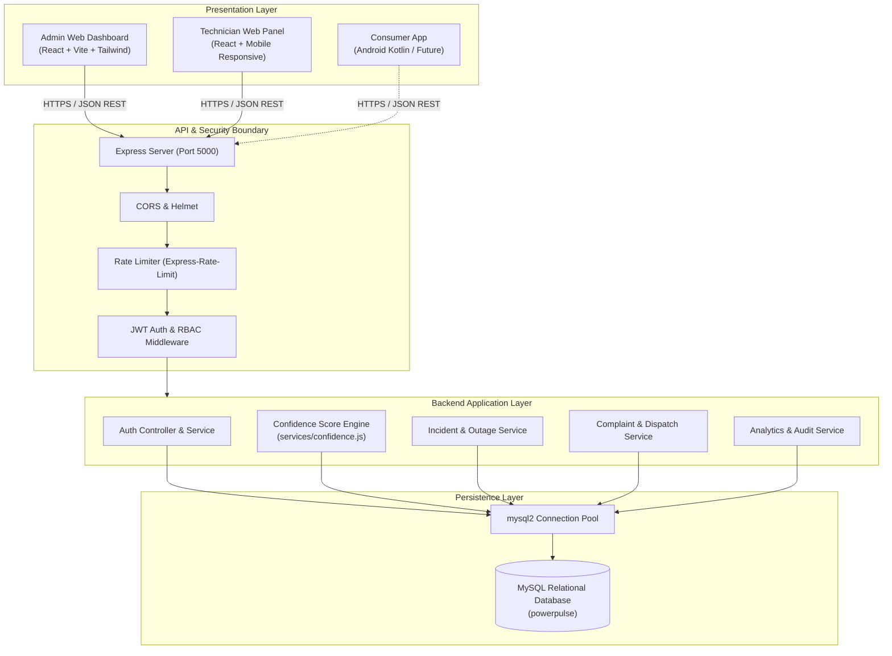
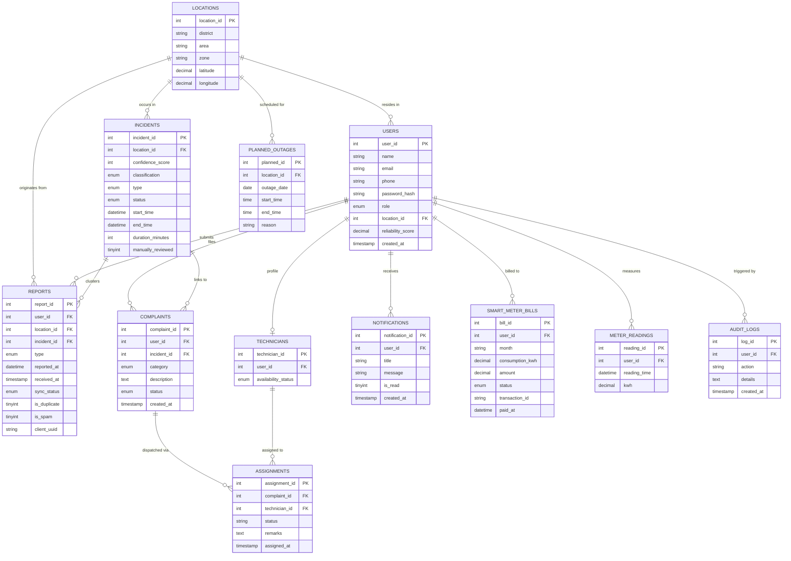
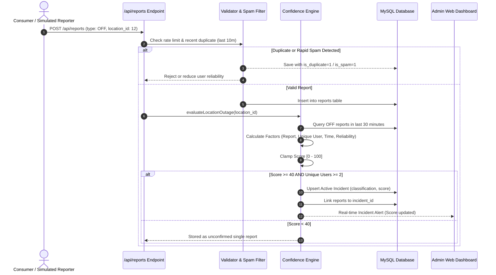

# PowerPulse: System Architecture Document

**Project:** PowerPulse – Smart Electricity Outage Intelligence & Management Platform  
**Target:** Full-Stack Web Platform (Admin Portal, Technician Panel, Backend API, MySQL)  
**Status:** Architectural Specification Baseline  

---

## 1. High-Level System Topology

PowerPulse follows a decoupled client-server architecture. All frontend clients (Admin Web Portal, Technician Web Portal, and future Android native clients) interact strictly with a unified Node.js REST API server. No client connects directly to the MySQL database.



---

## 2. Technology Stack Selection

| Component | Technology | Rationale |
|-----------|------------|-----------|
| **Web Frontend** | **React 18 / 19 + Vite** | Blazing-fast development, Hot Module Replacement (HMR), component-driven UI for dashboard widgets. |
| **Styling & Design** | **Tailwind CSS + Lucide Icons** | Utility-first responsive design, modern dark/slate utility styling, accessible icons. |
| **Routing** | **React Router DOM v6** | Declarative client-side routing with role-based `<ProtectedRoute>` wrappers. |
| **Charts & Visuals** | **Recharts** | Declarative, SVG-based responsive charts for outage frequency, area metrics, and resolution rates. |
| **Map Rendering** | **Leaflet + OpenStreetMap** | Open-source, no external API keys required, lightweight interactive map for location tagging. |
| **Backend Runtime** | **Node.js (LTS) + Express.js** | Non-blocking asynchronous I/O, rich ecosystem, straightforward REST API routing. |
| **Database** | **MySQL 8.0+** | Strict relational schemas, foreign keys, transaction support for audit logs and incident states. |
| **Database Driver** | **`mysql2/promise`** | Connection pooling, Promise-based async/await syntax, native prepared statement support. |
| **Authentication** | **JSON Web Token (JWT) + bcrypt** | Stateless authentication with signed claims (`userId`, `role`), salted hashing for passwords. |
| **Validation & Security** | **express-validator, helmet, cors** | Strict request sanitization and standard HTTP security headers. |

---

## 3. Database Schema Architecture

The database is named `powerpulse`. It implements 12 interconnected tables enforcing referential integrity.

### 3.1 Entity-Relationship (ER) Diagram



---

## 4. Core Algorithm Architecture: Outage Confidence Engine

The distinguishing innovation of PowerPulse is its mathematical clustering algorithm (`backend/src/services/confidence.js`). Raw consumer reports are transformed into high-confidence incidents.



### 4.1 Mathematical Scoring Formulation

$$\text{Confidence Score} = \text{ReportFactor} + \text{UniqueUserFactor} + \text{TimeClusterFactor} + \text{ReliabilityFactor} - \text{Penalty}$$

1. **Report Factor (Max 30 pts):**
   $$\min(N_{\text{valid OFF reports}} \times 3, 30)$$
2. **Unique User Factor (Max 40 pts):**
   $$\min(N_{\text{distinct users}} \times 8, 40)$$
3. **Time Clustering Factor (Max 20 pts):**
   - $20\text{ pts}$ if all reports fall within 10 minutes.
   - $10\text{ pts}$ if all reports fall within 30 minutes.
   - $0\text{ pts}$ otherwise.
4. **User Reliability Factor (Max 10 pts):**
   $$\text{Avg}(\text{reliability\_score}) \times 10 \quad \text{where } \text{reliability\_score} \in [0.0, 1.0]$$
5. **Penalties:**
   $$\text{Penalty} = (N_{\text{duplicate}} \times 5) + (N_{\text{spam}} \times 10)$$

$$\text{Final Score} = \max(0, \min(100, \text{Raw Score}))$$

---

## 5. Directory Structure Baseline

```
PowerPulse/
├── brain/                   # Architecture, PRD, Decisions, Design, Todo
│   ├── prd.md
│   ├── architecture.md
│   ├── design.md
│   ├── decisions.md
│   └── todo.md
├── backend/                 # Node.js + Express API Server
│   ├── package.json
│   ├── .env.example
│   ├── server.js            # Entry point
│   └── src/
│       ├── config/          # db.js (MySQL pool connection)
│       ├── middleware/      # auth.js, role.js, rateLimit.js
│       ├── controllers/     # auth, incident, complaint, admin, tech controllers
│       ├── routes/          # REST route endpoints
│       ├── services/        # confidence.js, outageService.js
│       ├── scripts/         # schema.sql, seed.js, simulate.js
│       └── utils/           # helper functions, logger
├── web/                     # React + Vite Frontend Application
│   ├── package.json
│   ├── vite.config.js
│   ├── tailwind.config.js
│   ├── index.html
│   └── src/
│       ├── assets/
│       ├── components/      # Navbar, Sidebar, KPI Cards, StatusBadges, Modal
│       ├── context/         # AuthContext.jsx
│       ├── pages/           # Login, AdminDashboard, Incidents, Complaints,
│       │                    # PlannedOutages, Analytics, TechDashboard
│       ├── services/        # api.js (Axios instance with bearer interceptors)
│       └── App.jsx
├── android/                 # (Phase 2 Native Consumer App)
└── docs/                    # Proposals, defense slides, evaluation logs
```
