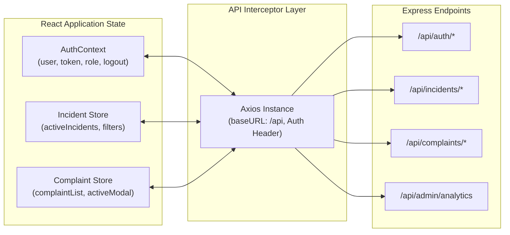

# PowerPulse: Web Application Design Specification

**Target:** Web Application (Admin Dashboard & Field Technician Panel)  
**Design Philosophy:** Clean, High-Contrast Utility Operations Interface  
**Status:** Design Baseline  

---

## 1. Design System & Visual Tokens

The PowerPulse Web Application is designed as a mission-critical utility monitoring platform. The aesthetic is clean, professional, and dark-accented with bright semantic indicators for rapid visual assessment during active power emergencies.

### 1.1 Color Tokens

```
+-------------------------------------------------------------------------+
|                              Color Tokens                               |
+-------------------+--------------------+--------------------------------+
| Token Name        | Hex Code           | Purpose / Usage                |
+-------------------+--------------------+--------------------------------+
| Primary / Electric| #0284C7 (Sky-600)  | Brand accents, primary buttons |
| Deep Brand        | #0F172A (Slate-900)| Dark navigation, header, cards |
| Background        | #F8FAFC (Slate-50) | Main application background    |
| Surface / Card    | #FFFFFF (White)    | Card surfaces, modals, tables  |
| Outage Red (High) | #EF4444 (Red-500)  | Confirmed outage, power OFF    |
| Warning Amber     | #F59E0B (Amber-500)| Probable outage, pending tasks |
| Possible Yellow   | #EAB308 (Yellow-500| Possible outage (40-69%)       |
| Restored Green    | #10B981 (Emerald)  | Power BACK, resolved, online   |
| Muted Gray        | #64748B (Slate-500)| Inactive text, borders, labels |
+-------------------+--------------------+--------------------------------+
```

### 1.2 Confidence Score Badges

| Score Range | Classification | Badge Styling | Visual Meaning |
|---|---|---|---|
| **0 – 39%** | **Low** | `bg-slate-100 text-slate-700 border-slate-300` | Unconfirmed / Single report |
| **40 – 69%** | **Possible** | `bg-yellow-100 text-yellow-800 border-yellow-300` | Early clustering detected |
| **70 – 89%** | **Probable** | `bg-amber-100 text-amber-800 border-amber-300` | High correlation, alerting |
| **90 – 100%** | **Confirmed**| `bg-red-100 text-red-800 border-red-300 font-bold`| Grid-wide outage confirmed |

---

## 2. Layout & Information Architecture

### 2.1 Admin Portal Layout (Desktop Optimized)

```
+-----------------------------------------------------------------------------+
| POWERPULSE ADMIN               [Search area / id]     (🔔 3) [👤 Admin Name]|
+-----------------+-----------------------------------------------------------+
| 📊 Dashboard    | KPI STATS ROW:                                            |
| ⚡ Incidents     | [ Active: 3 ]  [ Avg Dur: 1h 22m ]  [ Pending Comp: 8 ]   |
| 📝 Complaints   +-----------------------------------------------------------+
| 📅 Planned Out. | LIVE ACTIVE INCIDENTS (Sorted by Confidence Score)        |
| 👥 Users & Tech | +------+--------------------+------------+--------+------+ |
| 📈 Analytics    | | ID   | Area / District    | Conf. Score| Status |Action| |
| 🛡️ Audit Logs   | | #102 | Mirpur-10, Dhaka   | 92% (High) | Active |View  | |
|                 | | #104 | Dhanmondi 27, Dhaka| 65% (Poss) | Active |Review| |
| ⚙️ Settings     | +------+--------------------+------------+--------+------+ |
| 🚪 Logout       | RECENT ACTIVITY FEED & AREA OUTAGE MAP                    |
+-----------------+-----------------------------------------------------------+
```

### 2.2 Technician Portal Layout (Mobile & Field Responsive)

```
+-------------------------------------------------------------+
| POWERPULSE FIELD TECH                   [Status: 🟢 Available]|
+-------------------------------------------------------------+
| MY ACTIVE ASSIGNMENTS (2)                                   |
|                                                             |
| ┌─────────────────────────────────────────────────────────┐ |
| │ Ticket #CMP-1082: Transformer Blown                      │ |
| │ Location: Sector 4, Uttara, Dhaka                       │ |
| │ Consumer: Hasan Rahman (017XXXXXXXX)                    │ |
| │ Status: [ REPAIRING ]                                    │ |
| │ ------------------------------------------------------- │ |
| │ Progress:                                               │ |
| │ [Accept] -> [Investigate] -> [Repairing*] -> [Resolved] │ |
| │                                                         │ |
| │ [ 📝 Update Remarks / Parts Used ]                      │ |
| │ [ 🟢 Mark As Restored / Resolved ]                      │ |
| └─────────────────────────────────────────────────────────┘ |
+-------------------------------------------------------------+
```

---

## 3. Screen Specifications & Component Breakdown

### 3.1 Authentication Screen (`/login`)
- **Visuals:** Split screen (Illustration on left, modern card on right) or focused utility card.
- **Components:**
  - Email & Password input with show/hide password toggle.
  - Role preview indicator (Admin vs Technician quick-fill demo buttons for easy university grading & defense).
  - Validation error toaster alerts.

### 3.2 Admin Executive Dashboard (`/admin/dashboard`)
- **Key Performance Indicators (KPIs):**
  - **Active Outages**: Live count of unresolved incidents with a pulsing red badge.
  - **Restored Today**: Count of recovered zones in the past 24 hours.
  - **Pending Complaints**: Number of unresolved consumer complaints.
  - **Technicians on Duty**: Available vs Busy field staff.
- **Incident Overview Table:**
  - Columns: Incident ID, District & Area, Confidence Score Meter (colored bar), Start Time, Duration elapsed, Status, Action buttons.
  - Action modal: Click row to open full incident breakdown showing each reporter, timestamps, and confidence penalty factors.

### 3.3 Incidents Management Center (`/admin/incidents`)
- **Filter Bar:** Filter by Status (`Active`, `Restored`, `Dismissed`), Area, and Confidence Level (`Low`, `Possible`, `Probable`, `Confirmed`).
- **Interactive Controls:**
  - **Manual Confirm Button**: Sets `confidence_score = 100`, `manually_reviewed = 1`, and `classification = 'confirmed'`.
  - **Dismiss Button**: Marks the incident as `dismissed`, updates audit log, and penalizes inaccurate reporters.
  - **Outage Pairing Tool**: Inspects incoming BACK reports, computes total duration, and closes the incident.

### 3.4 Complaint & Dispatch Desk (`/admin/complaints`)
- **Columns:** Complaint ID, User Name, Contact, Area, Category (`power_outage`, `low_voltage`, `transformer`, etc.), Priority, Current Status, Assigned Technician.
- **Technician Assign Modal:**
  - Lists registered technicians with their current workload and status (`Available` in green, `Busy` in amber).
  - One-click assign triggers an automated assignment record and sets complaint status to `assigned`.

### 3.5 Planned Outage Scheduler (`/admin/planned`)
- **Scheduling Form:**
  - Location Selector (District -> Area -> Zone cascading dropdowns).
  - Date Picker, Start Time, and End Time.
  - Reason (e.g., "Grid Substation Transformer Maintenance").
- **Table of Published Schedules:** Allows editing, cancellations, or sending announcements.

### 3.6 Analytics & Reports (`/admin/analytics`)
- **Recharts Data Visualizations:**
  1. **Area Outage Frequency:** Horizontal Bar Chart comparing total outages across municipal zones (e.g., Mirpur vs Dhanmondi vs Uttara).
  2. **Hourly Incident Distribution:** Line Chart depicting peaks in outages throughout the day.
  3. **Complaint Category Breakdown:** Donut Chart displaying complaint types (e.g., 60% Power Outage, 20% Low Voltage, 15% Transformer).
  4. **Average Restoration Time:** Trend line tracking utility recovery efficiency over weeks.

### 3.7 Technician Task Desk (`/tech/assignments`)
- **Card-Based Task Flow:**
  - Clean card for each assigned ticket.
  - Action buttons triggering direct PATCH requests to `/api/technician/assignments/:id`:
    - `[Start Investigation]`
    - `[Commence Repair]`
    - `[Complete & Restore]`
  - Modal to input technician notes (e.g., "Replaced 50A drop-out fuse at Pole #12").

---

## 4. State Management & API Integration Flow


